# Borderline clips (adjudicated as ambiguous)

Three frames (start / middle / end) per clip. Source: `results/annotation/adjudication_reliability.csv`.

## `cosmos-drive-dreams/aggressive_takeover/agg_tk_012_Golden hour.mp4`
**Q:** On which side is the ego car overtaking ?  
**GT** Right · **annotator 2** Left · **final** Right  
You can say both. It is overtaking from the left and right side. I put right originally because it is forbidden. I did not state clearly to the second annotator.

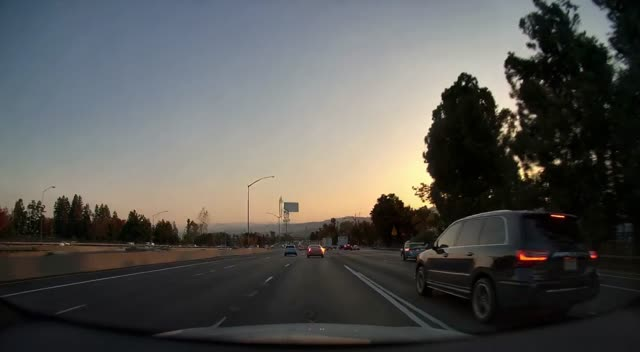 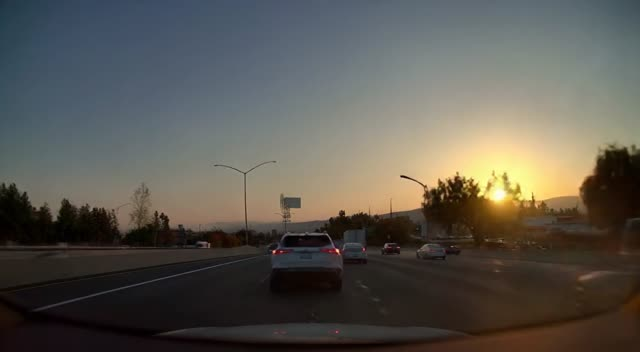 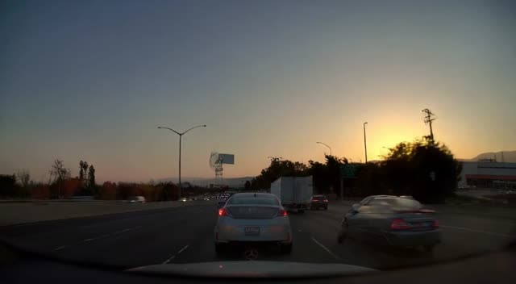

## `cosmos-drive-dreams/crossing_stop/cross_stop_018_Foggy.mp4`
**Q:** Overall, how safe is the driving of the ego car ? Give a score that ranges from 1 to 3 wit  
**GT** 1 · **annotator 2** 3 · **final** 1  
You never see the ego car crossing the stop line. This is why the second annotator put 3. I put 1 because, since I built the clip, I know that the ego car won't stop at the line. You can infer it because it is moving forwards at a certain speed while approaching the stop line before the cut. The cut is like on meter away from the stop so even if the ego car decides to stop, it would have breached the traffic laws.

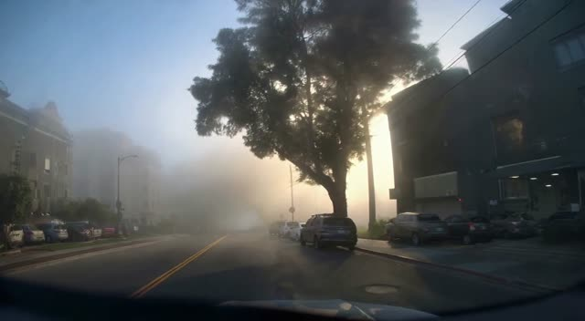 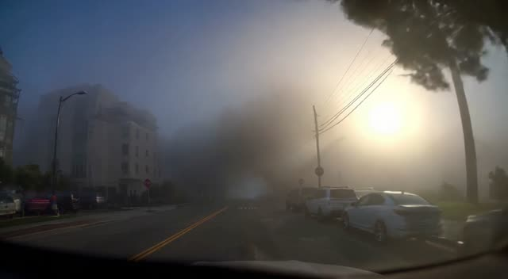 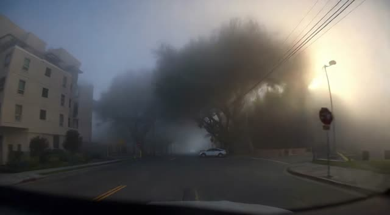

## `cosmos-drive-dreams/negative/07b2e448-3e55-41f5-ba38-e859bbdfcc42_685230399000_685250399000_1_Snowy.mp4`
**Q:** Overall, how safe is the driving of the ego car ? Give a score that ranges from 1 to 3 wit  
**GT** 3 · **annotator 2** 2 · **final** 3  
The video presents a strong artifacts with a line that would'nt exist in real life. I'll stick to 3 but 2 is understandable. It's not really a good question. It should be trimmed. It is one question over 7000+ so the difference is very little

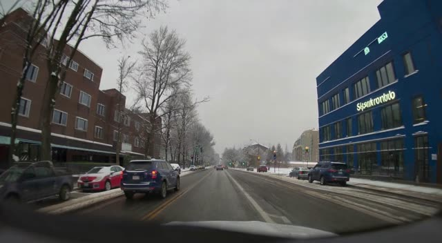 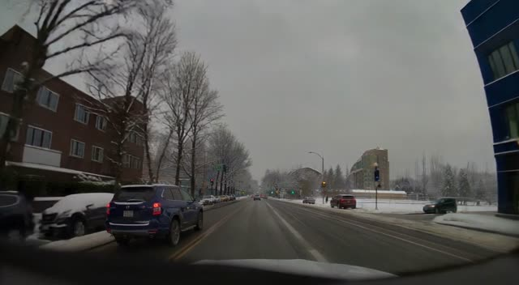 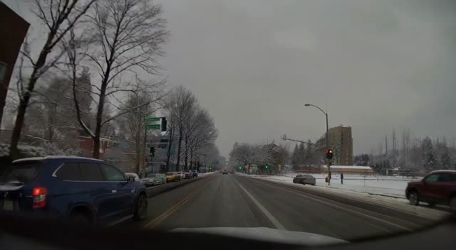

## `cosmos-predict1/artifacts/pedestrians_003.mp4`
**Q:** Does any object appear or disappear without continuous motion ?  
**GT** No · **annotator 2** Yes · **final** No  

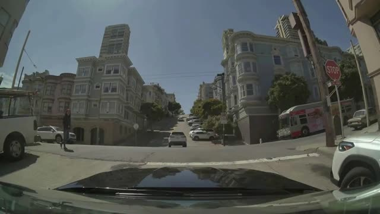 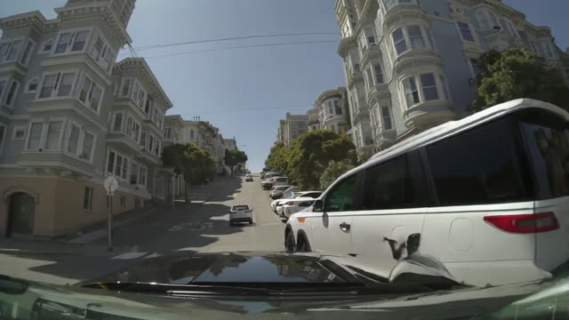 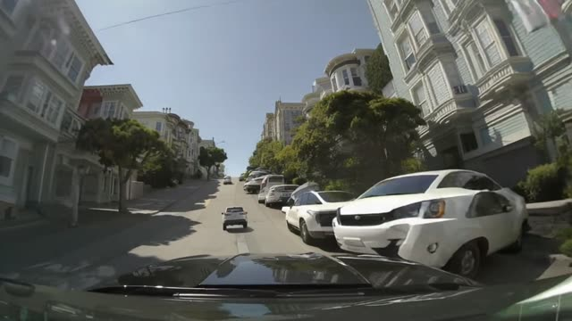
